---

I'm a first-year Computer Science student at **DIT University, Dehradun**. Most of what I know comes from breaking things and rebuilding them — right now that means phishing: what makes a link dangerous, what makes an email a scam, and how to *explain* a verdict instead of just printing "suspicious".

**Focus areas** — applied security tooling, Flask backends, evidence-first interfaces.

**Currently learning** — C, data structures, a bit of Java.

**Open to** — internship opportunities.

---

## What I'm building

### PhishGuard — phishing link & email checker
> Evidence-first verdicts and India-specific scam detection — a checker that shows its work.

A Flask application that analyses suspicious URLs and raw `.eml` messages:

- **URL analysis** — live RDAP, DNS and TLS lookups, plus lexical signals that fire before any network call returns
- **Email forensics** — real DKIM/SPF/DMARC checks, Reply-To and Return-Path mismatch detection, payment-identifier flags
- **Evidence, not guesses** — every verdict carries the signals behind it, their weight, and what was *not* observed

Built with **Garv Pahwa** and **Anshul Rawat**, deployed on Vercel.

---

## Toolbox

---

## Activity

---

<picture>
  <source media="(prefers-color-scheme: dark)" srcset="https://raw.githubusercontent.com/VirenayChauhan/VirenayChauhan/output/github-snake-dark.svg" />
  <source media="(prefers-color-scheme: light)" srcset="https://raw.githubusercontent.com/VirenayChauhan/VirenayChauhan/output/github-snake.svg" />
  
</picture>

---

